# FLUX


**FLUX** 是给 **nikki(mihomo)** 用的流量与路由器状态面板,以 Docker 容器的形式跑在你自己的路由器上(ImmortalWrt / OpenWrt)。

- 按 **设备 / 机场 / 节点 / 策略组 / 规则 / 访问目标** 统计流量,看实时速度和小时 / 天趋势
- 查某个域名走哪条规则、哪个节点,还能**实时测试**(不只看历史)
- 路由器状态、宽带质量、DNS 拦截(AdGuard Home)、告警与推送、UPS、Docker 容器、周对比 / 故障时间线 / Wi-Fi 事件
- 数据只存在你自己的路由器上(SQLite),不联网上报。面板对路由器和 nikki **只读**,只给建议,不替你改配置

> 截图用的是演示数据(模拟的 nikki / AdGuard / Docker),不是真实流量。外观默认是 Apple 风格,支持浅色 / 深色 / 随系统。

## 界面一览

| 概览(浅色) | 概览(深色) |
|---|---|
| 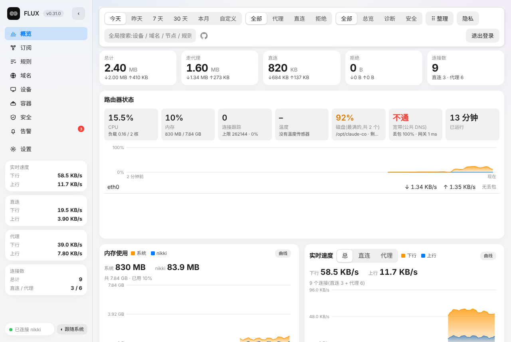 | 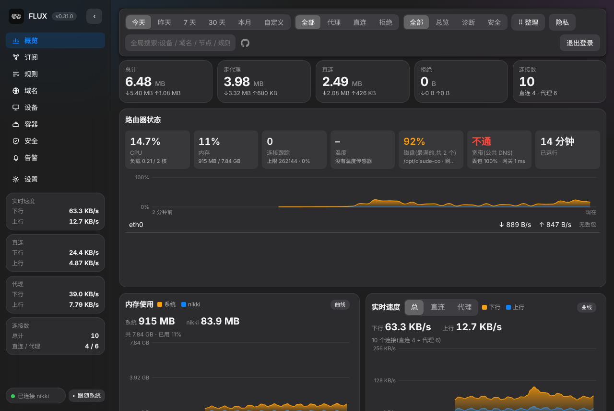 |

| 订阅与节点(评分 / 套餐) | 设备 |
|---|---|
| 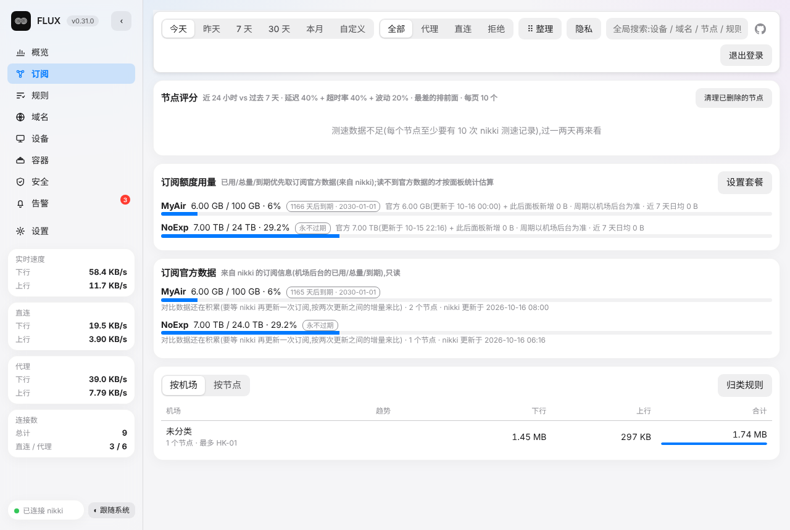 | 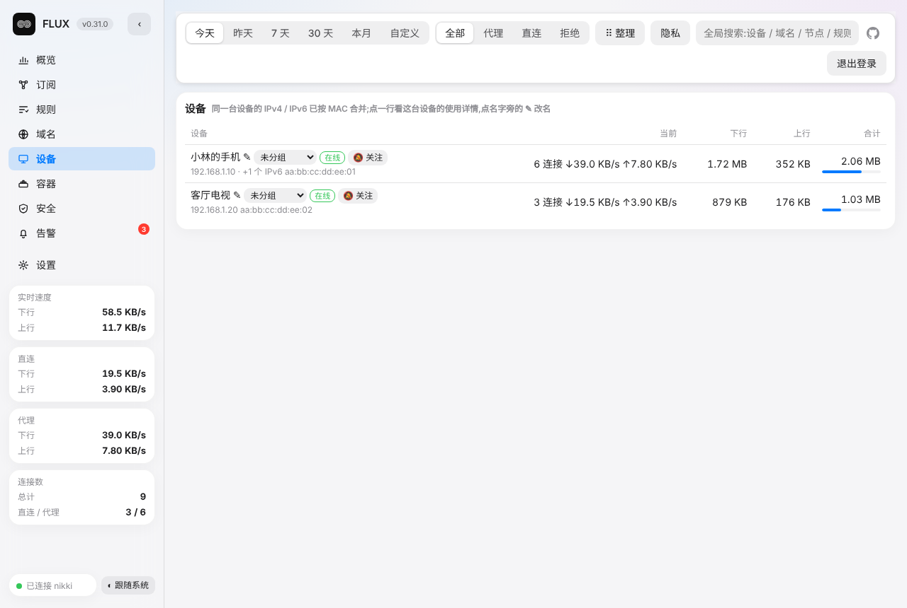 |

| 规则页 · 实时测试域名走什么规则 | 域名 · 查询一个域名的完整链路 |
|---|---|
| 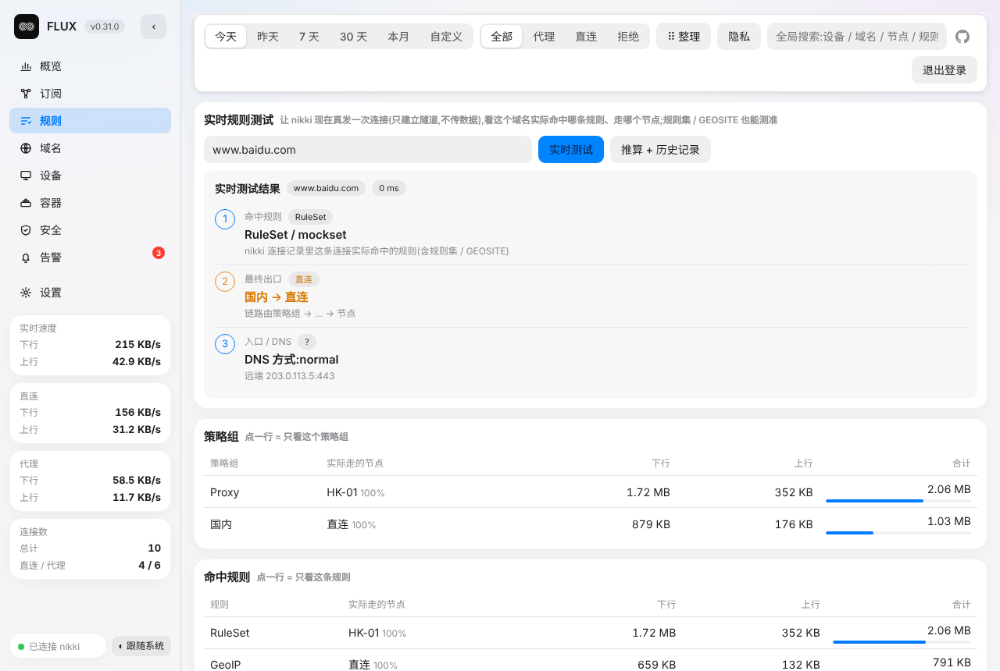 | 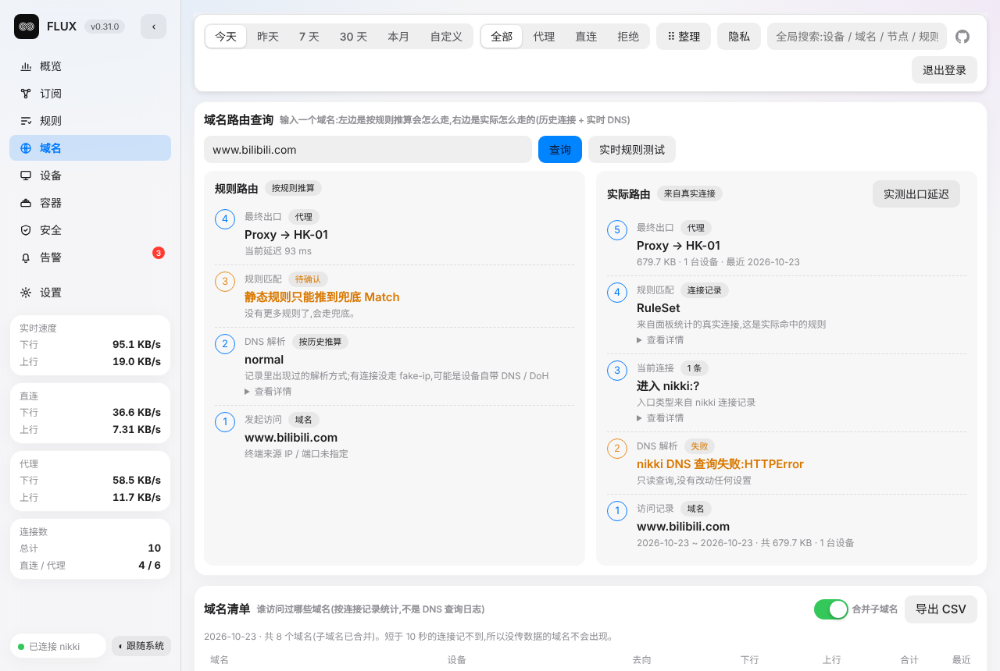 |

| 安全(DNS 过滤 / 分流检查 / 需要关注) | 周对比 / 故障时间线 / Wi-Fi 事件 |
|---|---|
| 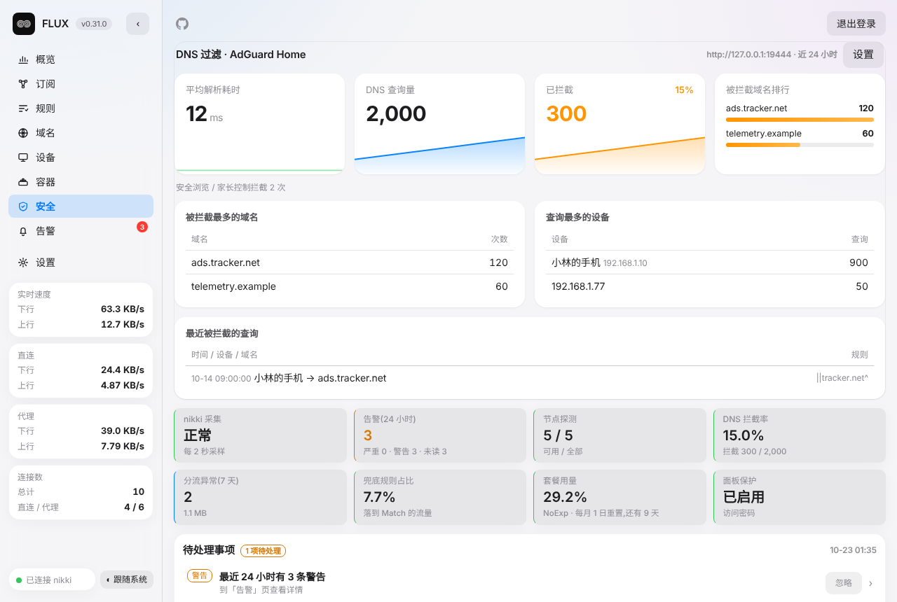 | 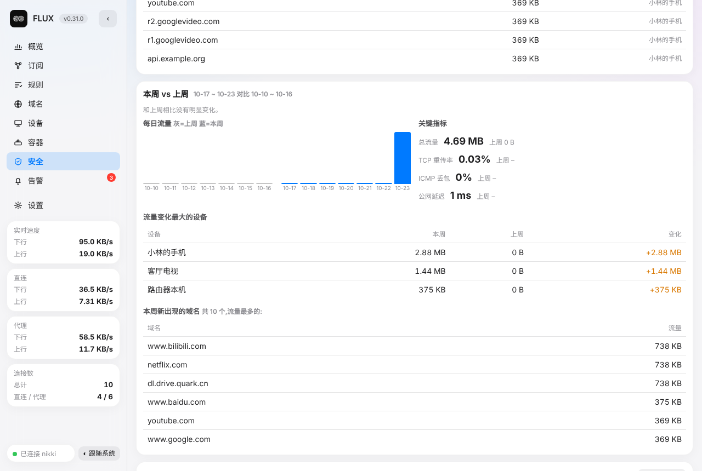 |

| 告警 | Docker 容器 |
|---|---|
| 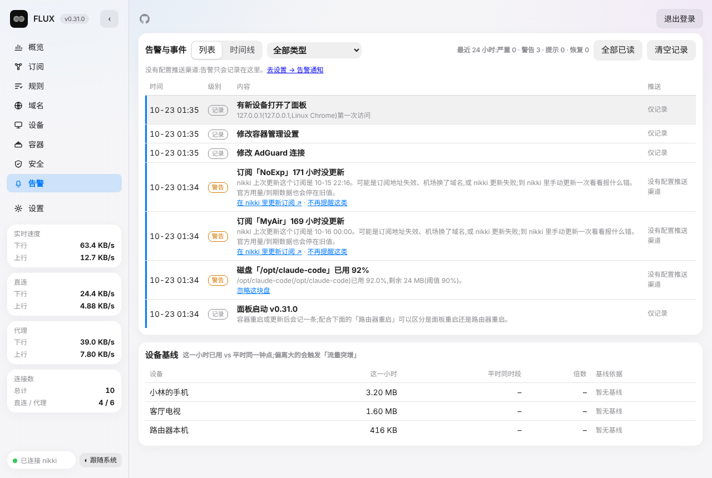 | 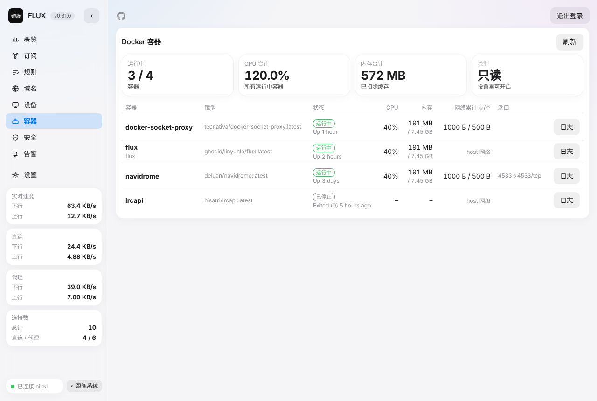 |

| 设置 | 登录页 |
|---|---|
| 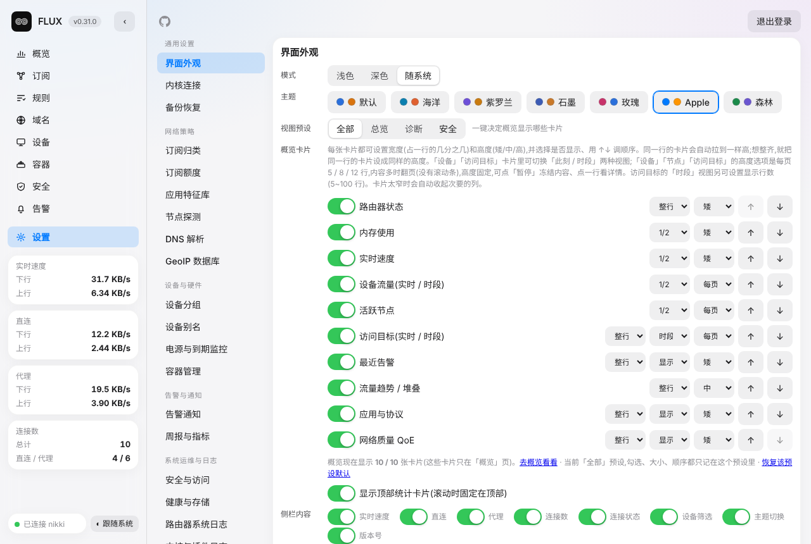 |  |

手机端(底部浮动导航,iOS 风格):

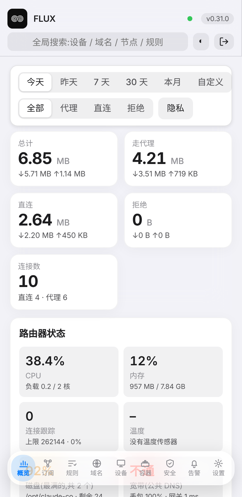 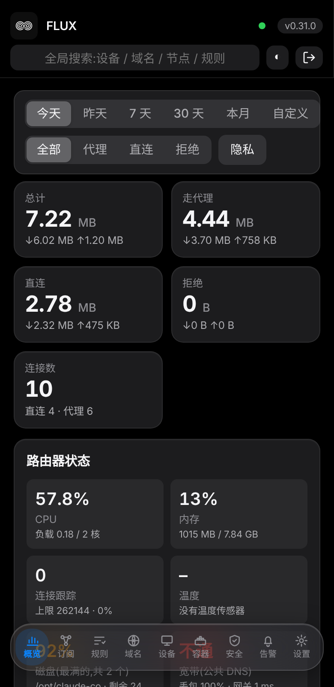

## 主要功能

| 模块 | 内容 |
|---|---|
| 概览 | 总流量、走代理 / 直连占比、实时速度、路由器状态(CPU / 内存 / 磁盘 / 宽带质量)、趋势图(柱 / 线 / 面积 / 平滑曲线)、设备与应用 Top、网络质量;卡片可拖动排序 |
| 订阅 | 机场套餐用量与到期、节点评分(延迟 / 超时 / 波动)、各机场 / 节点流量;订阅长时间没更新会告警并给出 nikki 里的失败原因 |
| 规则 | 规则命中统计、从未命中的规则、兜底 Match 占比;**实时测试**一个域名走哪条规则 |
| 域名 | 谁访问了什么、走直连还是代理;**域名查询**:规则链、DNS、AdGuard 过滤结果、历史记录、当前连接 |
| 设备 | 每台设备的流量、访问的域名、用到的节点;可起名、分组、设白名单,新设备入网 / 离线提醒 |
| 容器 | Docker 容器列表、资源占用、日志;可选启动 / 停止 / 重启 |
| 安全 | AdGuard Home 的 DNS 过滤统计、分流检查(国内站点误走代理等)、需要关注的清单、周对比、故障时间线、Wi-Fi 事件 |
| 告警 | 新设备、节点故障、流量突增、套餐、磁盘、宽带丢包、UPS、容器停止、路由器日志严重错误等,可推送到 Bark / Telegram / 企业微信 / 飞书 / ntfy / Webhook,支持「忽略」和静默时段 |
| 设置 | 外观、连接、告警与推送、备份与恢复、诊断包、可选功能开关 |

更完整的清单见 [docs/FEATURES.md](docs/FEATURES.md),版本历史见 [CHANGELOG.md](CHANGELOG.md)。

## 安装

**需要**:一台跑着 **nikki(mihomo)** 的路由器,已装好 Docker 和 docker compose;nikki 的 external-controller 已开启(默认 `127.0.0.1:9090`),记下密码(secret)。

```sh
mkdir -p /mnt/data/docker/flux && cd /mnt/data/docker/flux
# 把本仓库的 docker-compose.yml 放进来(可以 wget / 手动复制)
touch .env          # 可选配置见下面「环境变量」,空文件也行
docker compose up -d
```

1. 浏览器打开 `http://路由器IP:8099/`
2. **设置 → 连接**:填 nikki API 地址(同机一般 `http://127.0.0.1:9090`)和密码,点「验证并保存」
3. **设置 → 安全与隐私**:设一个登录密码(建议第一次就设)
4. 等几分钟,概览就有数据了(每 10 秒采样一次 `/connections`)

镜像是 `ghcr.io/linyunle/flux`,支持 amd64 / arm64。数据保存在 `./data`。

## 使用

- **顶部筛选**:时间、去向(全部 / 代理 / 直连 / 拒绝)、视图预设(全部 / 总览 / 诊断 / 安全)可以组合;点任何一行都能继续钻取
- **整理布局**:点「⠿ 整理」拖动卡片和左侧小卡(电脑端,Esc 退出),位置随外观设置保存
- **查一个域名**:「域名」页输入域名,看规则链、真实 DNS、AdGuard 过滤、历史访问
- **实时测试规则**:「规则」页输入域名点「实时测试」,面板经 nikki 的 mixed 端口发一次 CONNECT(不传数据),从连接列表读出命中的规则和出口。需要 nikki 开了 mixed-port 且不要求代理认证
- **待处理事项**:安全页底部的清单,点进去处理后,顶部有「返回安全」按钮
- **nikki 面板链接**:订阅告警里的「在 nikki 里更新订阅 ↗」默认用你访问 FLUX 时的主机名;不是同一个地址时,在 **设置 → 连接** 里填主机名、控制端口、路径
- **查看者账号**:可设只读账号,看不到敏感页,不能做实时测试等主动操作

## 可选功能(都在「设置」里,默认关闭)

- **AdGuard Home(只读)**:设置 → DNS 填 AdGuard 的地址、用户名、密码,安全页就能看 DNS 查询和拦截统计。账号密码只保存在你的 data 目录。
- **路由器日志**:设置 → 路由器日志 开启接收(默认 UDP 5514),然后让路由器把日志转发过来:
  ```sh
  uci set system.@system[0].log_ip='127.0.0.1'
  uci set system.@system[0].log_port='5514'
  uci set system.@system[0].log_proto='udp'
  uci commit system && /etc/init.d/log restart
  ```
  严重级别的日志(磁盘 I/O 错误、OOM、内核崩溃等)会进告警。可以设忽略关键词来过滤 crond 之类的噪音。
- **UPS(NUT)**:设置 → UPS 与到期,填 NUT 的地址、端口(默认 3493)和 UPS 名称。只读,不发控制命令,断电 / 电量低 / 读不到会告警。
- **证书 / 域名到期**:同一页,填要检查的域名(证书)和注册域名,到期前提醒。
- **Docker 容器页**:不要把 `docker.sock` 直接挂进容器。用只读的 socket-proxy,再在「设置 → 容器」填 `http://127.0.0.1:2375`:
  ```yaml
  services:
    docker-socket-proxy:
      image: tecnativa/docker-socket-proxy:latest
      container_name: docker-socket-proxy
      restart: unless-stopped
      ports:
        - "127.0.0.1:2375:2375"
      environment:
        CONTAINERS: 1
        POST: 0
      volumes:
        - /var/run/docker.sock:/var/run/docker.sock:ro
  ```
  默认只读;要在页面里启动 / 停止 / 重启容器,需要先设面板访问密码并在设置里单独开启(面板自己和 socket-proxy 不允许被操作)。
- **机场套餐 / 周报 / 推送渠道**:设置 → 机场套餐、周报与监控、告警与推送。
- **GeoIP 库**:设置 → 目的地数据库(下载可走 nikki 的代理,代理认证在这里填)。

## 更新

```sh
cd /mnt/data/docker/flux && docker compose pull && docker compose up -d
docker logs flux 2>&1 | grep -E "采集开始|自动备份"   # 看到「采集开始 vX.Y.Z」就是新版本
```

数据在 `./data`,更新不丢;升级时面板会自动做一次备份。升级前也可以在 **设置 → 备份与恢复** 手动下载一份。新版本发布后,面板里会有「有新版本」提示。

## 备份与恢复

**设置 → 备份与恢复** 导出一个文件(外观、告警规则、设备名与分组、AdGuard / 推送等配置;密码类敏感项仅在你勾选时才包含)。换机或重装后在同一位置导入,会逐项显示恢复了什么。

## 卸载

```sh
cd /mnt/data/docker/flux
docker compose down                 # 停止并删除容器
docker image rm ghcr.io/linyunle/flux   # 可选:删除镜像
rm -rf /mnt/data/docker/flux        # 可选:删除数据(./data 里的统计库、备份、配置),不可恢复
```

只想暂停:`docker compose stop`。想保留历史数据重装:只删容器和镜像,保留 `./data`。
FLUX 不会修改 nikki 配置,也没有往路由器系统里写任何东西,卸载后无需额外清理;
如果你开了「路由器日志」接收,可把路由器的日志转发改回去:`uci delete system.@system[0].log_ip && uci commit system && /etc/init.d/log restart`。

## 常见问题

- **打不开 / 8099 端口被占用?** 在 **设置 → 连接 → 面板自己的访问地址和端口** 改端口:会先在新地址多开一个监听,跳到新地址点确认才生效,120 秒内没确认自动撤销。启动时端口被占用会自动顺延到下一个空闲端口。实在打不开:删掉 `data/listen.json` 再 `docker restart flux`。
- **nikki 改了密码或地址?** 设置 → 连接 里重新填,可以先点「只测试连接」。mihomo 的接口只有「地址 + 密码」,没有用户名;代理认证(GeoIP 下载走代理)和 AdGuard 的账号分别在「目的地数据库」和「DNS」里填。状态栏的圆点变红时,点一下直接跳到这里。
- **想换回以前的外观?** 设置 → 外观 → 配色,选「默认」(或别的预设)即可,不用重装。
- **每台设备显示成 IP / MAC?** 在设备页点名字旁边的 ✎ 起名,或「设备 → 导入设备名」粘贴 `uci show dhcp` 的静态表。
- **诊断问题?** 设置 → 审计日志 可以下载「诊断包」(默认把 IP / MAC / 设备名打码,不含任何密码或口令),发给别人帮忙看很方便;「安全」页顶部还有自检清单。
- **重启路由器后容器页连不上?** 若 Docker 比磁盘挂载先启动,执行一次 `docker restart flux`。

## 遇到问题 / 如何反馈

1. 先看上面的「常见问题」和 [CHANGELOG.md](CHANGELOG.md),确认已是最新版本
2. 到 **[GitHub Issues](https://github.com/linyunle/FLUX/issues/new/choose)** 新建 Issue(选「问题反馈」或「功能建议」模板),尽量写清:
   - FLUX 版本(左上角版本号)、路由器 / Docker 环境
   - 做了什么、期望看到什么、实际看到什么;最好附界面截图
   - **诊断包**:**设置 → 审计日志 → 下载诊断包(已打码)**(默认把 IP / MAC / 设备名打码,不含密码或口令)
   - 容器日志:`docker logs --tail 200 flux`
3. **不要**在 Issue 里贴密码、Token、订阅链接、nikki secret、AdGuard 账号等;截图和日志发出前请自行检查并打码
4. 安全漏洞请不要公开发 Issue,在仓库 Security 页用「Report a vulnerability」私下报告

## 环境变量(都可选,写在 `.env`)

| 变量 | 默认 | 说明 |
|---|---|---|
| `NIKKI_API` / `NIKKI_SECRET` | `http://127.0.0.1:9090` / 空 | nikki 接口,也可以在网页「设置 → 连接」里填 |
| `LISTEN_HOST` / `LISTEN_PORT` | `0.0.0.0` / `8099` | 面板监听地址;也可以在网页里改 |
| `PANEL_PASSWORD` | 空 | 登录密码(也可在网页里设置) |
| `INTERVAL_SEC` | `10` | 采样间隔 |
| `KEEP_DAYS` / `HOUR_KEEP_DAYS` | `90` / `14` | 按天 / 按小时数据保留天数 |
| `WAN_IFACE` | 自动 | WAN 网卡名,用于和路由器实际总量对账 |
| `METRICS_TOKEN` | 空 | 给 Prometheus 抓 `/metrics` 的口令 |
| `PAGE_TOKEN` | 空 | 非空则网页和接口都要带 `?t=<token>` |

## 开发

```sh
python3 tests/test_units.py && python3 tests/test_e2e.py
python3 tests/smoke_ui.py     # 可选:需要 playwright + chromium
python3 tests/docshots.py     # 重新生成 README 截图(演示数据)
```

推一个 `v*` 标签(或按仓库的 Actions 配置推送 main),GitHub Actions 会构建 amd64 + arm64 镜像并推到 `ghcr.io/<owner>/flux`,同时创建 Release。首次发布后到 Packages 页面把包设为 Public,路由器才能免登录拉取。

### 精度说明
- 每 10 秒采样一次 `/connections`,短于一个周期的连接看不到,连接关闭前最后一个周期的字节会丢
- 不经过 nikki 的流量(绕过大陆 IP、局域网内互访、路由器自身)统计不到;设置 `WAN_IFACE` 可对账 WAN 实际总量
- 目的地国家只对「能看到真实目的地」的连接有效(直连、非 fake-ip);经代理的流量只能看到节点所在国家
- 分流检查用内置的常见域名清单,只是排查线索

### 在 sun-panel 等导航页里用 FLUX 的 logo
公开 logo 地址(不需要口令):`http://路由器IP:8099/logo.png`(512×512 PNG);仓库里也有一份:`https://raw.githubusercontent.com/linyunle/FLUX/main/assets/logo.png`。
